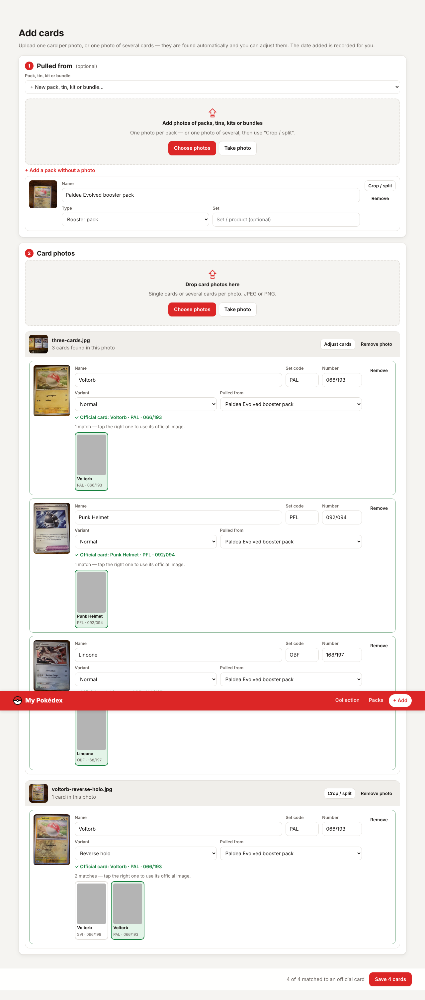
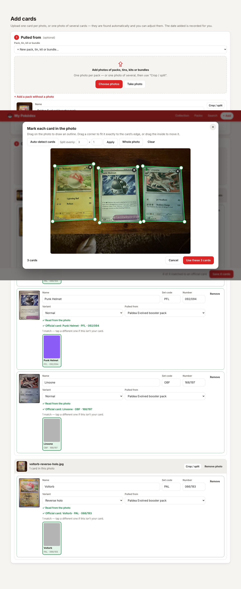
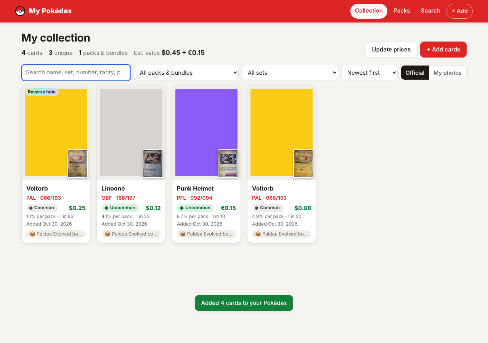
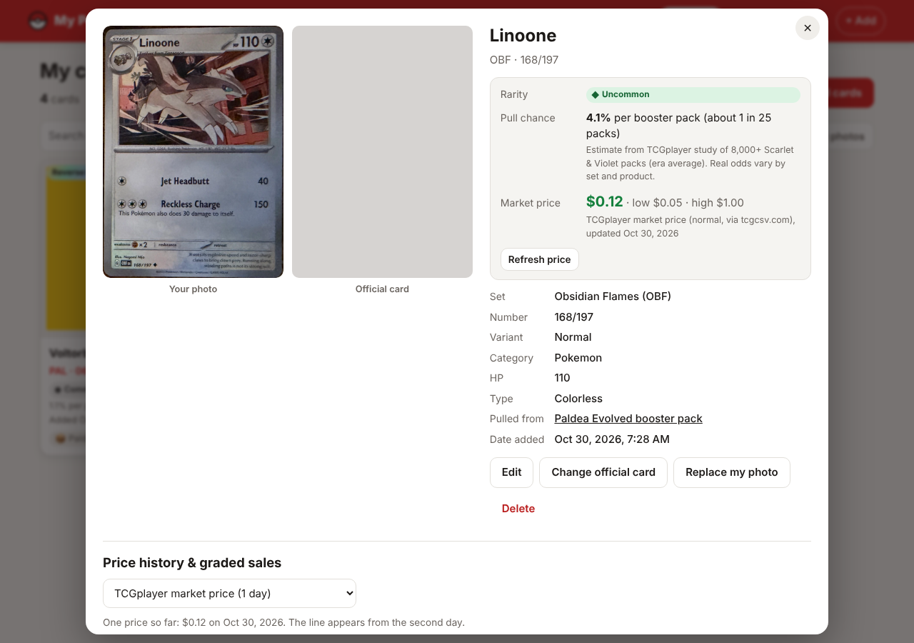
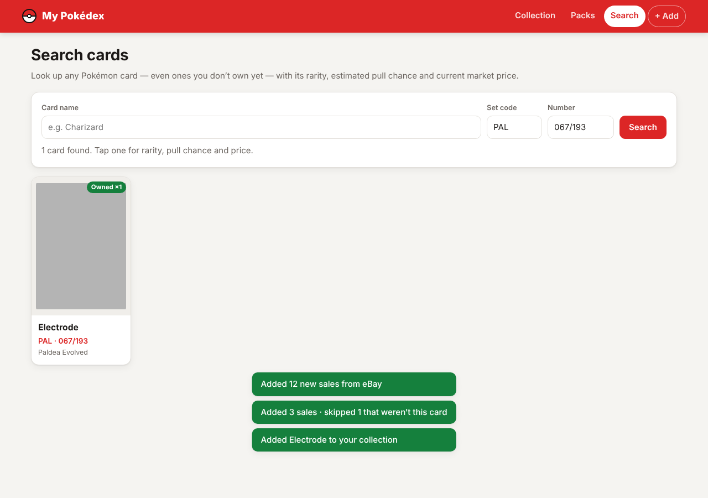
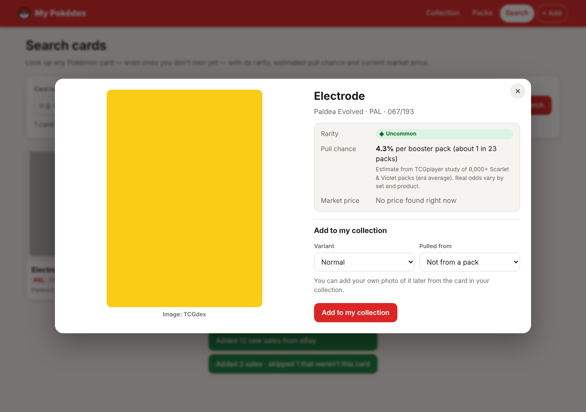
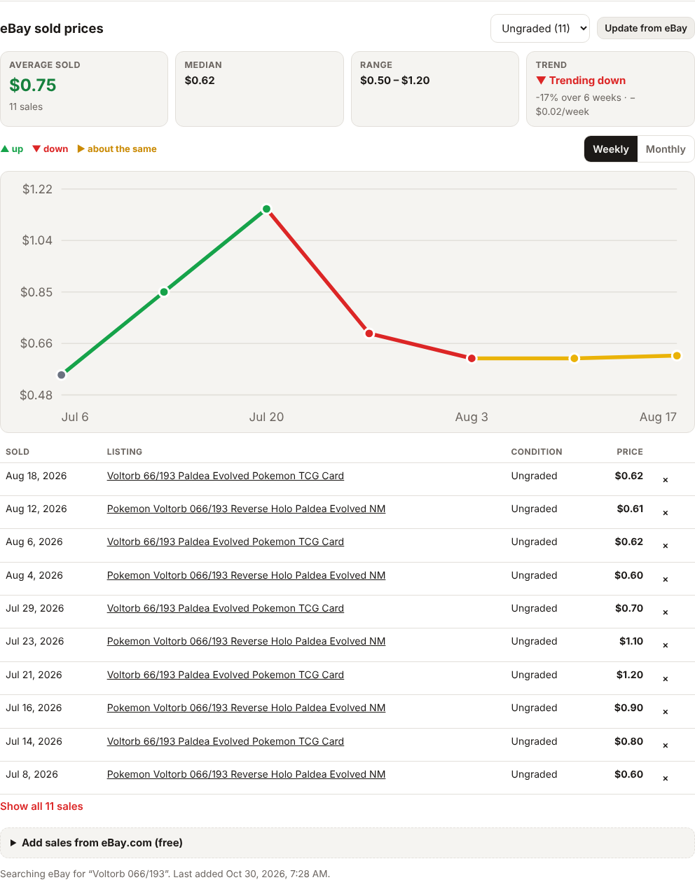
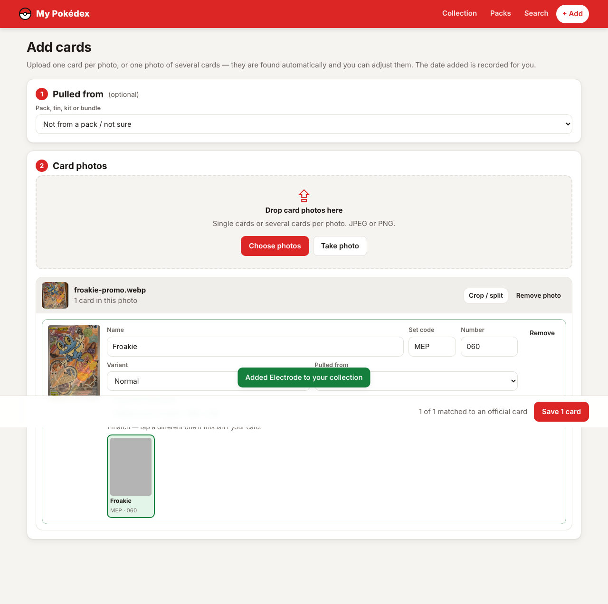
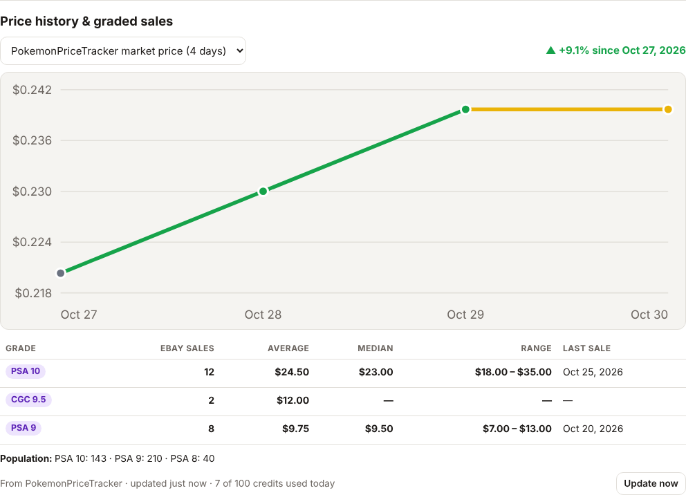

# My Pokédex — a personal Pokémon card collection catalog

Catalog the Pokémon cards you pull and the packs, tins, kits and bundles they came from.

- **Upload cards one at a time or in batches.** Add as many photos as you like. Each card in a photo is found automatically, **cut out along its own edges and straightened**, even when it's tilted, photographed at an angle or fills the whole photo. Only the card is kept, with transparent rounded corners, so no table or background shows. A photo of several cards (like [`docs/reference/three-cards.jpg`](docs/reference/three-cards.jpg)) becomes several cards. You can fine-tune any outline by dragging its corners in the crop editor.
- **Cards are read automatically.** The app reads the **name**, **set code** and **number** printed on each card (e.g. `PAL 066/193`, or `MEP 060` on promos) and fills them in, then matches the official card, so normally there's nothing to type. You can still correct anything it gets wrong.
- **Optionally record where each card came from.** Upload one or more photos of packs, tins, kits, bundles, Elite Trainer Boxes and so on (or add one without a photo), and link the cards to them.
- **Official artwork when it exists.** Type the set code and number printed at the bottom left of the card (e.g. `PAL` `066/193`), or just the name, and the app finds the card in the free [TCGdex](https://tcgdex.dev) database. If TCGdex has no match or no picture, it checks the open [Pokémon TCG dataset](https://github.com/PokemonTCG/pokemon-tcg-data), which covers every English set. It keeps a local copy of the official image next to your own photo.
- **Rarity, pull chance and price on every card.** Each card shows its rarity (● Common, ◆ Uncommon, ★ Rare, ★★ Double Rare…), an **estimated chance of pulling it from one booster pack**, and an **estimated market price**. The collection page adds up the total value. Prices refresh automatically when you open a card, or all at once with **Update prices**.
- **eBay sold prices.** Open any card in your collection to see its **average sold price** on eBay (plus median and range), a **price trend chart** (weekly or monthly averages; the line is **green** where the price went up, **red** where it went down and **yellow** where it stayed about the same, within 2%), the overall direction and rate of change, and **every sold listing** behind those numbers (title with link, sold price, date, condition / grade). Filter by ungraded or graded sales, and remove any listing that isn't really your card.
- **Price history and eBay graded sales.** Every card keeps its own **day-by-day price history** in the database, saved automatically while the app runs, so you build up long-term history for free. With a free [PokemonPriceTracker](https://www.pokemonpricetracker.com/) key, the card page also shows **eBay sales by grade** (PSA 10, CGC 9.5, raw…: count, average, median, range), recent price history from PokemonPriceTracker, and grading population when your plan includes it. The app keeps well inside the free 100 credits a day by itself.
- **Search any card.** The **Search** page looks up any Pokémon card, not just the ones you own, with its rarity, pull chance and price, and you can add it to your collection in one click.
- **Date added is recorded** for every card and pack.
- **Saved between sessions.** Everything goes into a SQLite database and an image folder on disk, so it's still there after you close the browser or restart the server.
- **Searchable.** Search the whole collection by name, set, number (`066/193`), rarity, type, variant, pack name or notes. You can filter by pack/bundle (or "not from a pack") and by set, or search inside a single pack.

| Add cards: found, cut out, read and matched automatically | Crop editor: drag the corners to fit tilted cards |
| --- | --- |
|  |  |
| **Collection** | **Card: your photo + official image** |
|  |  |
| **Search any card** | **Rarity, pull chance and price** |
|  |  |
| **eBay sold prices: average, trend chart, listings** | **A promo read from a photo** |
|  |  |
| **Price history & eBay graded sales** | |
|  | |

> The screenshots come from the automated test, which runs against a mock card database, so the "official" images there are flat placeholder colours. In normal use they are the real card PNGs.

## Running it

Requires **Node.js 22.5 or newer** (it uses the built-in `node:sqlite`).

```bash
npm install
npm start            # http://localhost:3000
```

| Environment variable | Default | Purpose |
| --- | --- | --- |
| `PORT` | `3000` | HTTP port |
| `DATA_DIR` | `./data` | Where the database (`collection.db`) and images are stored. Back up this folder to back up your collection. |
| `TCGDEX_URL` | `https://api.tcgdex.net/v2/en` | Main card database (cards, images, prices) |
| `PTCG_DATA_URL` | `https://raw.githubusercontent.com/PokemonTCG/pokemon-tcg-data/master` | Second card source (cards, images, rarities) |
| `TCGCSV_URL` | `https://tcgcsv.com/tcgplayer/3` | Backup price source (TCGplayer prices) |
| `EBAY_CLIENT_ID`, `EBAY_CLIENT_SECRET` | (not set) | eBay app keys, for automatic sold listings once eBay approves the Marketplace Insights API |
| `EBAY_MARKETPLACE` | `EBAY_US` | Which eBay site to read sold listings from (e.g. `EBAY_GB`) |
| `POKEMONPRICETRACKER_API_KEY` | (not set) | Free PokemonPriceTracker key, for eBay graded sales and extra price history (see below) |
| `POKEMONPRICETRACKER_DAILY_CREDITS` | `100` | Your plan's daily credits. The app never spends more than this in a day. |
| `POKEMONPRICETRACKER_HISTORY_DAYS` | `3` | Days of price history to ask for per card (the free plan allows 3) |

To check which online sources your computer can reach, run `npm run check:live`. It looks up the three reference cards in every source and prints what each one returns.

To use it from your phone, run it on a computer on your home network and open `http://<computer-ip>:3000`. The **Take photo** button opens the camera.

## How to add cards

1. Go to **+ Add**.
2. *(Optional)* Under **Pulled from**, pick an existing pack, or choose **New pack, tin, kit or bundle…** and upload one or more photos of them.
3. Drop in card photos. Cards are found in each photo automatically. Use **Adjust cards** / **Crop / split** to fix the boxes: draw, drag, resize, delete, *Auto-detect* again, *Split evenly* (e.g. 3 × 1) or *Whole photo*.
4. For each card, type the **set code** and **number** from the bottom-left corner, or the **name**. Matching official cards appear, and if there's exactly one it is selected for you. Set the variant (reverse holo, holo…) if you like.
5. Click **Save**. If the online database can't be reached, the card is still saved with your photo. You can link it later from the card's **Find official card** / **Retry official image** buttons.

## eBay sold prices: two free ways to get them

eBay closed its open sold-listings API in 2025, and scraping eBay breaks its rules (sold searches also require signing in now), so the app supports the two free, allowed routes. Listings are saved with the card either way, so its price history keeps growing.

1. **Copy and paste (works right away).** On a card, open **Add sales from eBay.com**, then click **Open the sold listings on eBay**. That's eBay's own "Sold items" search for the card (e.g. `Voltorb 066/193`). Sign in to eBay if asked, select the results (Ctrl+A / ⌘A, or "Select all" on a phone), copy, and paste them into the box. The app reads each listing's title, price, sale date, condition and link. It keeps only sales of that exact card (same name and number, and the same set total when shown) and skips lots, bundles and other cards.
2. **eBay's official API (automatic).** eBay's Marketplace Insights API returns the last 90 days of sold listings. It's free, but eBay must approve your developer app for it:
   1. Create a free account at [developer.eBay.com](https://developer.ebay.com/) and create a production keyset (App ID / Cert ID).
   2. Apply for access to the **Marketplace Insights API** (a limited-release API; eBay reviews requests).
   3. Once approved, start the app with `EBAY_CLIENT_ID=<App ID> EBAY_CLIENT_SECRET=<Cert ID> npm start` (on Windows PowerShell: `$env:EBAY_CLIENT_ID="…"; $env:EBAY_CLIENT_SECRET="…"; npm start`).
   
   An **Update from eBay** button then appears on every card. Until approval, the app says so and you can keep using copy and paste.

**How the numbers are worked out:** the average is the mean of the sold prices shown (all, ungraded only or graded only). The chart plots the average for each week (Monday to Sunday) or month, and each step is coloured by how it compares with the period before: more than +2% green, more than −2% red, otherwise yellow. The overall trend is a straight line fitted through every sale, so one odd sale can't flip it. Its slope is the rate per week, and its rise or fall over the period, relative to the average price, gives the % change.

## Price history and eBay graded sales (PokemonPriceTracker)

The app already gets everyday prices for free (TCGplayer and Cardmarket via TCGdex and tcgcsv.com). Two things are added on top:

**Your own price history (always on, no key needed).** Each card's price is saved once per day into the database (`price_history` table): when you add it, when you open it, and from a background job that runs a minute after start-up and then every hour while the app is open. Any card not yet priced that day is updated. The **Price history & graded sales** section on a card draws each saved series as a daily chart (green up, red down, yellow flat), with the change since the first day. The longer the app runs, the longer the history.

**PokemonPriceTracker (optional, free key).** Adds eBay sales grouped by grade, its own recent price history and, on plans that include it, population counts.

1. Sign up at [pokemonpricetracker.com](https://www.pokemonpricetracker.com/) (free plan: 100 credits a day, no credit card) and copy your API key.
2. Start the app with the key:
   ```bash
   POKEMONPRICETRACKER_API_KEY=your-key npm start
   ```
   On Windows PowerShell: `$env:POKEMONPRICETRACKER_API_KEY="your-key"; npm start`. The start-up message says `PokemonPriceTracker: on (100 credits a day)`.
3. Open any card. Its graded sales appear under **Price history & graded sales**, with the credits used today and an **Update now** button.

**How the 100 credits a day are kept.** A card costs about 3 credits (1 for the card, 1 for history, 1 for eBay sales).

- **Cached for a day.** A card's data is fetched at most once a day; opening it again uses the saved copy. PokemonPriceTracker only updates daily anyway.
- **No searches when avoidable.** The card's TCGplayer id usually comes free from TCGdex. Otherwise, one small search (up to 3 credits) is made once, and the id is remembered. The search result must match the card's number, set total and set name.
- **Counted per day.** Credits spent are recorded in the database (`api_usage` table), along with the remaining credits PokemonPriceTracker reports, so restarts don't reset the count. Nothing is spent once the day's credits are used up. The saved data is shown instead.
- **A share is kept for you.** The hourly background job refreshes the cards with the oldest data, but it always leaves 30% of the day’s credits unspent, so cards you open yourself can still update.
- **Failures aren't retried all day.** A card PokemonPriceTracker doesn't have, or a failed request, waits a day before being tried again.
- **No double calls.** Two requests for the same card at the same moment share one call.

With 100 credits, that's roughly 30 cards refreshed a day. Every answer is also written into your local price history: PokemonPriceTracker's market price history, plus the average for each grade. Individual eBay sales it returns are added to the card's eBay sold listings.

> PokemonPriceTracker's API layout differs between its docs pages, so the app reads several layouts. If something doesn't show up with your key, the card page shows the error message it received.

## How cards are cut out and read

Both run inside your browser, so your photos aren't sent to any outside service. The tools are served by the app itself: [OpenCV.js](https://docs.opencv.org/) for finding cards and [Tesseract.js](https://tesseract.projectnaptha.com/) for reading text, about 25 MB downloaded once and then cached by the browser.

1. **Find each card:** looks for card-shaped outlines (63 × 88 mm) by brightness and by edges, then snaps each side onto the card's real outer edge so the border is never cut off.
2. **Straighten it:** a perspective correction turns each outline into a flat, upright card picture.
3. **Read it:** OCR reads the name strip at the top (or the second line on Trainer cards) and the set code and number at the bottom left, several times with different image processing.
4. **Match it** (`POST /api/identify`): the server votes across those readings. It fixes typical misreads (a slash read as "7", "0" for "O", a dropped leading zero), looks the card up by set and number, and checks that the name agrees before filling anything in automatically. If it isn't sure, it shows its best guesses and asks you to pick.

Small print in blurry or dim photos can still defeat it. In that case, type the details as before.

## Where the numbers come from

| | Source | Notes |
| --- | --- | --- |
| Card details & images | [TCGdex](https://tcgdex.dev), then the [Pokémon TCG dataset](https://github.com/PokemonTCG/pokemon-tcg-data) | Both are free and need no API key. |
| Rarity | The card's own data | Same rarity names as printed on the card. |
| Market price | TCGplayer market price (USD) via TCGdex, then Cardmarket trend (EUR) via TCGdex, then TCGplayer via [tcgcsv.com](https://tcgcsv.com) | Uses the price for your variant (e.g. reverse holo) when there is one. Prices change: treat them as a guide, not an offer. |
| Pull chance | Calculated | See below. |

**Pull chance** is an *estimate* for one booster pack:

> chance = (how many cards of that rarity an average pack holds) ÷ (how many cards of that rarity are in the set)

- Commons: 4 per pack. Uncommons: 3 per pack. Reverse holos: about 2 per pack, shared with every common, uncommon and rare.
- Double Rare, Ultra Rare, Illustration Rare, Special Illustration Rare, Hyper Rare and ACE SPEC use the per-pack rates published by TCGplayer from thousands of opened packs. Scarlet & Violet base set, 151, Temporal Forces and Phantasmal Flames use their own studies. Other Scarlet & Violet and Mega Evolution sets use the era average.
- The number of cards of each rarity in a set comes from the Pokémon TCG dataset.
- There's no estimate for older eras or for special sets with a different pack layout (Paldean Fates, Prismatic Evolutions, Black Bolt / White Flare, Ascended Heroes, 30th Celebration, promos…).

Real odds vary by product (booster packs, ETBs, bundles) and from box to box, so this tells you how rare a card is, not what you'll pull.

## Project layout

```
server/
  index.js      start-up (env config)
  app.js        Express routes: cards, packs, lookup, uploads, media
  db.js         SQLite schema + queries (search, filters, stats)
  catalog.js    combines the sources: search, details, image fallback, market info
  tcg.js        TCGdex client: lookup by set code/number/name, details, prices, image download
  ptcgData.js   Pokémon TCG dataset client (second source, rarity counts per set)
  prices.js     picks the right price for a variant; tcgcsv.com backup prices
  pullRates.js  pull-chance estimates
  identify.js   turns OCR readings into the actual card
  ebay.js       eBay's official sold-listings API + the eBay search for a card
  soldStats.js  average sold price, weekly/monthly trends, matching listings to a card
  setCodes.js   printed set codes (PAL, OBF, PFL…) → TCGdex set ids
  priceTracker.js         PokemonPriceTracker API client + reading its answers
  priceTrackerService.js  daily credit budget, caching, saving into the price history
  scheduler.js  hourly background job: daily price snapshot + PokemonPriceTracker top-ups
public/         no-build frontend (vanilla ES modules)
  js/add.js     upload flow for cards and packs
  js/cropper.js crop / split editor
  js/images.js  cropping + automatic card detection in photos
  js/lookup.js  official-card picker
  js/vision.js  finds cards in photos and straightens them (OpenCV.js)
  js/ocr.js     reads the name / set code / number off a card (Tesseract.js)
  js/ebay.js    eBay sold prices panel: trend chart, listings, reading pasted eBay results
  js/history.js price history chart + PokemonPriceTracker graded sales
  js/views.js   collection, packs, pack page, card dialog
  js/search.js  search any card online
tests/
  api.test.js     API tests (node:test) against mock sources
  market.test.js  pull chances, prices, second source, market API
  identify.test.js  card identification from real OCR readings of the reference photos
  ebay.test.js    sold-price statistics, trend colours, listing matching, eBay API + routes
  pricetracker.test.js  PokemonPriceTracker client, caching, credit budget, price history, scheduler
  fixtures/ptcg   real Pokémon TCG dataset files for a few sets
  e2e/run.js    browser walkthrough with Playwright using docs/reference photos
docs/reference/ the reference photos used for the upload feature and the tests
```

### API

| Method & path | Description |
| --- | --- |
| `GET /api/cards?q=&packId=&setCode=&sort=` | Search / list cards (`packId=none` for cards not from a pack; `sort` = `oldest`, `name`, `set`, `value` or `rarity`) |
| `POST /api/cards` | Add one or more cards: multipart with `cards` (JSON array) and one image per card referenced by `photoField` |
| `PATCH /api/cards/:id` | Edit a card. Changing `tcg_id` re-links it and fetches the official image |
| `POST /api/cards/:id/refresh-official` | Retry downloading the official image |
| `POST /api/cards/:id/refresh-market` · `POST /api/cards/refresh-market` | Refresh rarity, pull chance and price for one card · for every card |
| `GET /api/catalog/cards/:id?variant=` | Any online card with its rarity, pull chance and price |
| `POST /api/cards/:id/photo` · `DELETE /api/cards/:id` | Replace photo · delete |
| `GET /api/packs?q=` · `POST /api/packs` | List · add one or more packs (same multipart format, key `packs`) |
| `PATCH /api/packs/:id` · `POST /api/packs/:id/photo` · `DELETE /api/packs/:id[?withCards=1]` | Edit · replace photo · delete (cards are kept unless `withCards=1`) |
| `GET /api/lookup?name=&setCode=&number=` | Search the online card database |
| `GET /api/cards/:id/ebay?condition=all\|raw\|graded` | Average sold price, weekly/monthly trend and the stored eBay sold listings |
| `POST /api/cards/:id/ebay/refresh` · `POST /api/cards/:id/ebay/import` · `DELETE /api/cards/:id/ebay/:saleId` | Fetch from eBay's API · add pasted listings `{ listings: [...] }` · remove a listing |
| `GET /api/cards/:id/price-history?days=` | The card's saved daily price history, one series per source / grade, with change and direction |
| `GET /api/pricetracker/status` | Whether a key is set, and credits used / left today |
| `GET /api/cards/:id/pricetracker` · `POST /api/cards/:id/pricetracker/refresh[?force=1]` | Saved PokemonPriceTracker data (no credits used) · update it (uses the cache if under a day old, unless `force`; never exceeds the daily credits) |
| `POST /api/identify` | Identify a card from OCR readings `{ names: [...], lines: [...] }` |
| `GET /api/meta` | Pack kinds, variants, known set codes, stats |

## Tests

```bash
npm test             # API tests
npm run test:e2e     # browser walkthrough (needs Playwright + Chromium); SCREENSHOTS=1 refreshes docs/screenshots
```

Both suites use local mocks of the online sources (`tests/helpers/mock-sources.js`), so they don't need internet access. The Pokémon TCG dataset mock serves real data files.
