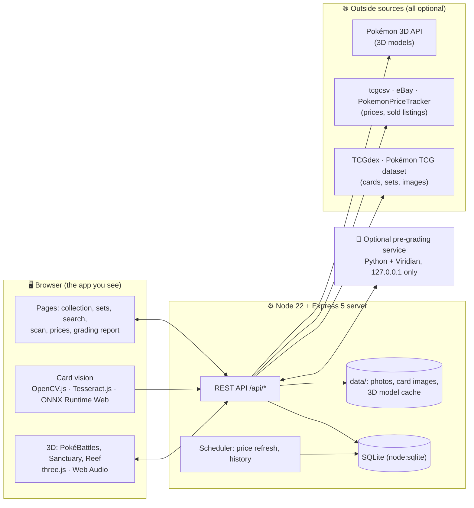
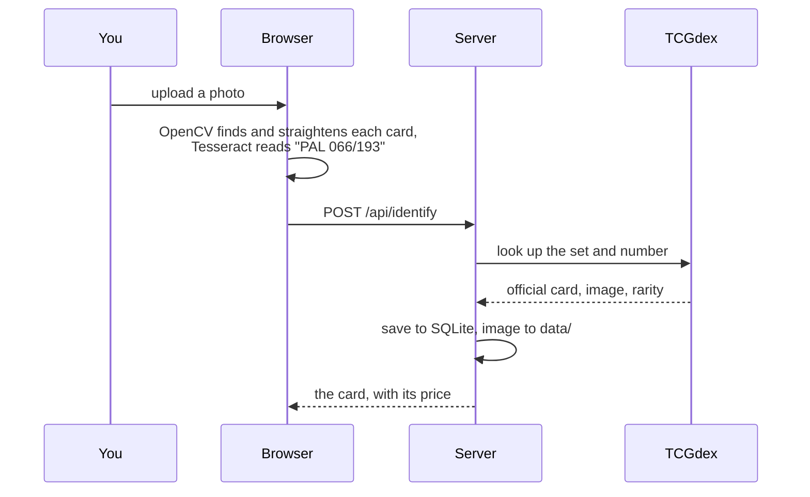
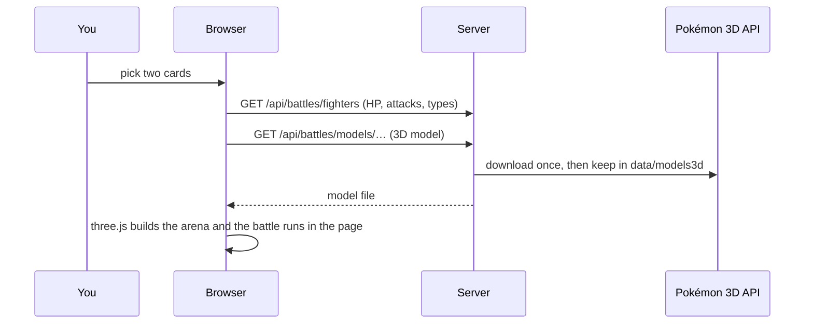

# Architecture at a glance

**What it is:** a personal Pokémon card collection app. Photograph or scan your cards, and the app works out which
card each one is, keeps it with its price history, and brings it to life in 3D battles and a 3D Sanctuary.

**Where it runs:** on your own PC (browser or the Windows desktop app), or on a free always-on cloud server. Each
install keeps its own collection; nothing is shared with anyone else.

## The big picture

**How the code gets to each machine:** the desktop app (`desktop/launcher.mjs`) and the cloud server
(`launcher.mjs --server`) download the newest commit on `main` and update themselves. They roll back if a new
version doesn't start.

## Tech stack

| Layer | Technology | Why |
| --- | --- | --- |
| Front end | Plain JavaScript modules, HTML, CSS; an importmap and **no build step** | Edit a file and reload; nothing to compile |
| 3D | **three.js 0.180** (WebGL), custom shaders, Web Audio | Battles, Sanctuary, Reef and 3D Pop-out, all drawn in code |
| Card vision | **OpenCV.js 4.12** (finding card edges), **Tesseract.js 7** (reading text, English and Japanese), **ONNX Runtime Web 1.30**, heic2any (iPhone photos) | Runs in the browser, in Web Workers, with no cloud AI |
| Server | **Node 22**, **Express 5**, multer (uploads) | One small process serves the pages and the API |
| Database | **SQLite** through Node's built-in `node:sqlite`, with versioned migrations | One file, no database server to install |
| Pre-grading | **Python** service running the MIT-licensed **Viridian** engine | Optional; only on your own machine |
| Desktop app | A small Windows launcher (`Pokedex.cs` → `launcher.mjs`) that opens the app in an Edge or Chrome window | Feels like an app; updates itself |
| Cloud | Any Linux VM (`scripts/cloud-setup.sh`) behind Tailscale for HTTPS | Always on, reachable from a phone |
| Tests | `node:test` (unit and API), **Playwright** (full browser walkthrough) | Every feature has a check |
| CI | GitHub Actions on **Linux** and **Windows** | Windows matches the desktop app |

## What each part does

| Feature | What it does | Main code |
| --- | --- | --- |
| Collection | Cards, copies, packs, conditions, filters, Trash, CSV | `server/app.js`, `server/db.js`, `public/js/views.js` |
| Card lookup | Finds the official card and picture from set code and number, or name | `server/catalog.js`, `server/tcg.js`, `server/ptcgData.js` |
| Adding by photo | Finds each card in a photo, straightens it and reads its name and number | `public/js/vision/`, `public/js/ocr.js`, `server/identify.js` |
| Scan deck | Live camera scanning, matched by a perceptual hash | `public/js/scan/`, `public/js/scanner.js` |
| Prices | Market price, daily history, eBay sold listings, graded sales | `server/prices.js`, `server/ebay.js`, `server/priceTracker*.js`, `server/scheduler.js` |
| Sets | Completion, checklists, rarity counts, pull chances | `server/sets.js`, `server/pullRates.js` |
| Pre-grading | Centering, corners, edges and surface from two photos (experimental) | `server/grading/`, `services/grading/` |
| PokéBattles | Card battles in 3D: turn-based or real-time, 6 arenas, weather | `public/js/battle/`, `server/battle.js`, `server/models3d.js` |
| Sanctuary | Walk among your Pokémon in their habitats, or dive to the Reef | `public/js/sanctuary/`, `public/js/reef/` |
| 3D Pop-out | A Pokémon steps out of its card in the gallery | `public/js/popoutRender.js`, `server/cardDioramas.js` |
| Accounts | Profiles, sign-in, one collection per person | `server/auth.js` |

## Two typical flows

**Adding a card from a photo**

**Starting a battle**

## Where data lives

| What | Where |
| --- | --- |
| Cards, copies, packs, users, price history, grading reports | SQLite file in `data/` |
| Your photos and official card images | `data/uploads/` and nearby folders |
| Downloaded 3D models and pop-out pictures | `data/models3d/`, `data/popout/` (a download cache, like the rest of `data/`) |
| Settings such as graphics level, trainer and sound | The browser's local storage |
| Backups (cloud server) | A nightly copy next to the app folder |

## Key design choices

- **No build step, few dependencies.** Plain modules served as they are, with nine runtime packages.
- **Logic separate from drawing.** Battle rules, real-time combat, movement and the Reef's swimming are pure functions with tests. The 3D code only draws them.
- **Everything 3D is made in code.** Grass, trees, water, stadiums and the Reef are generated in code; only Pokémon models are downloaded.
- **Graphics that adapt.** The levels are High, Standard and Basic. Slow frames turn effects off, then lower the resolution, and a crashed load starts one level lower next time.
- **Outside services are optional.** Every source has a fallback or a local copy. The app works offline with what it has already saved.

The 3D games in depth: [GAME_ARCHITECTURE](GAME_ARCHITECTURE.md).

More detail: [README](../README.md) (features and setup), [USER_GUIDE](USER_GUIDE.md) (how to use it),
[SOURCES](SOURCES.md) (data sources and credits), [HISTORY](HISTORY.md) (how it was built).
