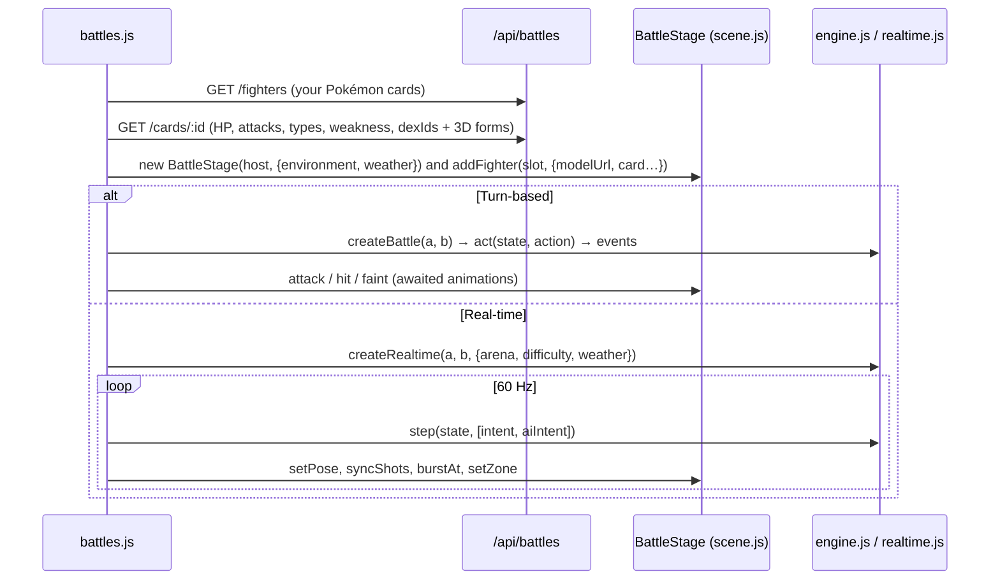
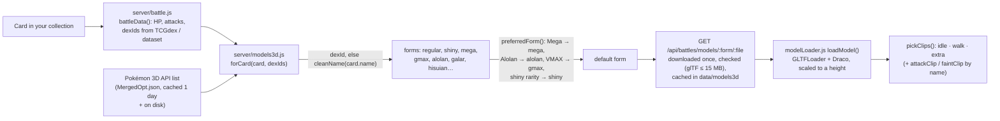

# Game architecture: PokéBattles, the Sanctuary and the Reef

The 3D side of the app: how it is built, which file owns what, and where to make common changes. For the
whole app see [ARCHITECTURE.md](ARCHITECTURE.md).

## At a glance

```mermaid
flowchart TB
  subgraph Pages["Pages (routing + UI)"]
    B["battles.js<br/>#/battles"]
    S["sanctuary/sanctuary.js<br/>#/sanctuary"]
    R["sanctuary/reefSanctuary.js<br/>#/sanctuary/reef"]
  end

  subgraph Logic["Pure logic (no three.js, unit-tested)"]
    ENG["battle/engine.js<br/>turn-based rules"]
    RT["battle/realtime.js<br/>real-time sim + AI"]
    PL["sanctuary/player.js<br/>walk · jump · glide · swim"]
    ZOO["sanctuary/zoo.js<br/>habitats · creature AI"]
    HP["sanctuary/habitats.js<br/>planHabitats · solidAt"]
    LK["sanctuary/look.js<br/>camera smoothing"]
    ARN["battle/arenas.js<br/>arena · weather lists"]
  end

  subgraph Render["Rendering (three.js 0.180)"]
    ST["battle/scene.js<br/>BattleStage / FlatStage"]
    W["battle/world.js<br/>buildWorld: sky, terrain, grass, trees, lake"]
    STD["battle/stadiums.js<br/>night · floating · league · beach"]
    REEF["reef/reef.js<br/>buildReef"]
    SF["battle/surface.js<br/>normal maps, leaf/needle cards, contact shadows"]
    WX["battle/weatherFx.js"]
    FX["battle/postfx.js<br/>AO · bloom · mirror water"]
    PF["battle/perf.js<br/>dynamic resolution, crash-safe start"]
  end

  subgraph Shared["Shared"]
    CTL["battle/controls.js<br/>keyboard · gamepad · touch"]
    ML["battle/modelLoader.js<br/>glTF + Draco, pickClips"]
    TR["sanctuary/trainer.js"]
    UI["sanctuary/sanctuaryUI.js<br/>wheel · trainer picker · stamina"]
    AMB["ambience.js<br/>Web Audio"]
  end

  SRV["Server: /api/battles/*<br/>server/battle.js · server/models3d.js"]

  B --> ENG & RT & ST & ARN & CTL
  ST --> W --> STD & REEF & SF & WX & FX
  ST --> ML & PF
  S --> PL & ZOO & HP & LK & W & ML & TR & UI & AMB & CTL & PF
  R --> PL & ZOO & REEF & ML & TR & UI & AMB & CTL & PF & FX
  B & S & R --> SRV
```



**The one rule that keeps this easy to change:** game rules, movement and AI live in **pure modules**. They hold
plain objects, take a fixed time step and return events. The three.js code only **reads** that state and draws it.
Pure modules are tested in Node (`tests/*.test.js`) with no browser.

## The frame loop

```text
every animation frame (renderer.setAnimationLoop)
  ├─ read input        controls.js → intents  (keyboard / gamepad / touch → { x, z, jump, dodge, move… })
  ├─ step the logic    realtime.step(state, intents)    | stepPlayer / stepSwimmer + stepCreature / stepDrifter
  │                    (fixed 1/60 s steps, accumulated)
  ├─ apply to 3D       setPose / follow / syncShots     | trainer + creature transforms, animation mixers
  ├─ update the world  world.update(t)  (sky, grass sway, water, weather, reef life)
  ├─ draw              world.render() → postfx (High) or renderer.render
  └─ perf.frame(dt)    lowers effects, then pixels, when slow
```

## PokéBattles

### Flow


### Files
| File | Owns |
| --- | --- |
| `battles.js` | The page: picker, arena/weather/style/difficulty choice, showcase, turn UI, real-time HUD |
| `battle/engine.js` | Turn rules: energy, attack cost, damage (`damageFor`), weakness/resistance, weather (`weatherBoost`), CPU choice |
| `battle/realtime.js` | Real-time sim: movement, jump, dodge with i-frames, projectiles, combo stun, knockdown, ring-out, closing field, `aiIntent` with reaction delay. Tuning constants sit at the top of the file |
| `battle/arenas.js` | Lists of arenas, weathers, styles, difficulties + the saved choice (`pokedex.battleArena`) |
| `battle/scene.js` | `BattleStage` (three.js): camera, platforms, fighters, Poké Ball summon, effects, the overlay. `FlatStage`: the same API in CSS when WebGL is missing |
| `battle/controls.js` | Key maps for players 1 and 2, `readGamepad` (dead zone, edge-triggered buttons), touch joystick |

### Recipes
- **New attack effect:** add it in `scene.js` (`#projectile`, `#burst`, `#sparkles`). `TYPE_COLORS` picks the colour by type.
- **Balance real-time:** change the constants at the top of `realtime.js` (`SPEED`, `ENERGY_*`, `DODGE_CHARGES`, `DIFFICULTY`). Then run `node --test tests/realtime.test.js`.
- **New rule in turn-based:** add it to `engine.js` (pure) with a test in `tests/battleEngine.test.js`. The UI picks the events up from `act()`.
- **New arena:**
  1. add an entry to `ENVIRONMENTS` (`arenas.js`);
  2. add `ARENA_RULES[id]` (`realtime.js`: radius, wall or ring-out, shrink);
  3. build the arena: a builder in `stadiums.js` with a `STADIUM_LOOK[id]` (sky, lights), or a branch in `buildWorld`;
  4. extend the arena-list test.

## 3D models: how a card becomes a Pokémon



- **Name matching:** `cleanName` strips suffixes (ex, V, VMAX, GX…) and prefixes (Mega, Alolan, Radiant…).
- **Changing the form:** players can pick another form in the UI. The `3D form` select in `battles.js` uses `FORM_LABELS`.
- **No model** (offline, or not in the list): the fighter appears as its card on the platform.
- **Realistic look** (High/Standard): `loadModel(…, { realistic, types })` swaps each material for `realisticMaterial` (physical, surface by `surfaceKind`, relief normal map from the colour texture, rim light). Tune the surfaces in `SURFACE` in `modelLoader.js`.
- **Animations** are found by clip name: regexes in `modelLoader.js`. For a model whose clips don't animate, widen those regexes.
- **Rights:** models are Nintendo IP from a fan project. They are downloaded for personal use and are never committed.
- **3D Pop-out** (`popoutRender.js`) reuses `loadModel` to draw one picture per model into `data/popout/`.

## The Sanctuary (meadow)

| File | Owns |
| --- | --- |
| `sanctuary/sanctuary.js` | The page and its frame loop. It builds the world (`buildWorld({ mode: 'sanctuary' })`), habitats, creatures and the trainer, and handles input, camera, travel keys 1–8, the dive prompt and ambience. Exposes `el.sanctuary` for tests |
| `sanctuary/player.js` | `MOVE` constants; `stepPlayer`: walk, sprint, jump with coyote time and a jump buffer, glider, stamina, slope limit, solid slide, wading and swimming at the lake |
| `sanctuary/zoo.js` | `HABITATS` (8: id, types, centre, radius), `habitatFor(card)`, `layoutHabitats`, `stepCreature` (wander, follow, idle, look at the trainer) |
| `sanctuary/habitats.js` | `planHabitats` (pure: where props go), `solidAt` (collision), `buildHabitats` (three.js props and signs) |
| `sanctuary/look.js` | Mouse and stick look, with two-stage smoothing; `ease(dt, rate) = 1 - exp(-dt·rate)` (frame-rate independent) |
| `sanctuary/trainer.js` | The trainer figure (`buildTrainer`) |
| `sanctuary/sanctuaryUI.js` | The owner's module: the radial wheel (Follow / Pet / Card / Battle), the trainer chooser (`pokedex.trainer`) and the stamina ring |

### Movement model (shared idea for land and water)
- **Pure stepping:** `stepX(entity, input, dt, world)` mutates the entity. `world` answers questions such as height at (x, z), water depth and solid at (x, z). Swap that `world` object in tests.
- **Velocity eases** towards the target (`accel` and `brake`), never jumps to it.
- **Solids:** the player slides along them (velocity into the solid is dropped). Swimming moves in sub-steps shorter than the body, so it never tunnels.
- **Stamina:** sprinting, gliding and fast swimming drain it. Running out sets `exhausted` until it recovers to `recovered`.

### Recipes
- **New habitat or type home:**
  1. add an entry to `HABITATS` (`zoo.js`);
  2. add its props in `planHabitats` and `buildHabitats`, with a sign;
  3. add a travel key in `sanctuary.js`.
- **Tune movement:** change `MOVE` / `SWIM` in `player.js`. The tests in `tests/sanctuary.test.js` and `tests/reef.test.js` cover jump height, coyote time, sliding and tunnelling.
- **New creature behaviour:** add a state to `stepCreature` (pure), then a new wheel action in `sanctuary.js` / `sanctuaryUI.js`.

## The Reef (underwater)

| File | Owns |
| --- | --- |
| `reef/reef.js` | `REEF` {top, radius} and `reefHeight` (seabed). `reefLayout` is pure: kelp, rocks, arches, wreck, whale tail, grotto, creature spots. `blockedBy` is the obstacle test. `stepSchool` drives the fish (boids-lite). `addCaustics` patches a shader. `buildReef` builds the 3D scene, with `setQuality` and `update` |
| `sanctuary/reefSanctuary.js` | The Reef page: swimmer, Water-type residents (`reefResidents`, `stepDrifter`), surfacing to the lake, wheel, sound |
| `sanctuary/player.js` | `stepSwimmer`: 3-D eased velocity, sub-step push-out and slide, surface ceiling, buoyancy, fast-swim stamina |
| `battle/world.js` | `reefWorld()`: the same reef as a battle arena |

The Reef follows Abyssal Garden (MIT, © 2026 Maksymilian Dendura). The manta, fish and sound graph are ported, with its notice in the files.

## Graphics pipeline

```text
buildWorld / buildReef  →  scene graph  →  world.render()
                                              ├─ Standard / Basic: renderer.render(scene, camera)
                                              └─ High: postfx.js
                                                   ├─ planarMirror  (lake / sea reflection, half res)
                                                   ├─ scene → "screen-like" HalfFloat target (MSAA + depth)
                                                   ├─ AO from depth (half res) · bloom (half + quarter blur)
                                                   └─ combine → screen
```

| Topic | Where | Notes |
| --- | --- | --- |
| Quality levels | `world.js` `setQuality`, `preferredQuality`, `pokedex.battleGraphics` | High / Standard / Basic. Basic has no shadows or grass and uses Lambert materials |
| Sky, fog, lights | `world.js` (meadow), `stadiums.js` `STADIUM_LOOK` + `lookFor(env, dark)` | ACES tone mapping. The sky dome follows the camera |
| Textures | Procedural (`noiseTexture`, `canvasTexture` / `speckle`, `leafClusterTexture`, `needleClusterTexture`); on High/Standard the **HD set** from `public/assets/realism/` (Poly Haven CC0) via `assets.js` + `hdScenery.js` | The ground blends grass / soil / sand / rock / snow by height, slope and lake (`groundWeights`, `aLayers` attribute, two scales, triplanar rock). Add an asset: add a slot to `scripts/fetch-realism-assets.mjs`, push (the workflow fetches it), use it through `surface(slot)` / `modelSet(slot)` |
| Vegetation | Instanced grass shader (`grassField`); `forest()`; `tree()`; leaf and needle cards (`leafCards`, `skirtGeometry`) | Cards sway in the vertex shader (`uTime`) |
| Water | Lake shader (`lake()`), beach sea (`stadiums.js`), mirror on High | Custom shaders write **display-referred** colour (`toneMapped: false`) |
| Light tricks | `surface.js`: sky environment map, contact shadows, `addSurfaceDepth`; `addCaustics` | |
| Post-processing | `postfx.js` `createEffects` | The render target is "screen-like" (`isXRRenderTarget` + sRGB), so custom shaders look the same with and without passes |
| Performance | `perf.js` | Slow frames: drop the effects, then lower the pixel ratio (down to 60%). A crashed load starts one level lower |

**When you add a shader:** if it writes final colour itself (`toneMapped: false`), it must give the same result on the screen and in a screen-like target. Then it works with postfx and the mirror unchanged. Check by comparing the High and Standard screenshots of the same view.

## Input and sound
- **Controls** (`controls.js`):
  - **Player 1:** WASD, Space jump, Shift dodge, Q / E / right click / F (or 1–4).
  - **Player 2:** arrows, K jump, L dodge, U / I / O / P (or numpad 1–4).
  - **Gamepad:** standard mapping via `readGamepad(index, memory)`: stick moves, A jumps, B dodges, LB / RB / LT / RT attack. Used by battles and both Sanctuaries.
  - **Touch:** joystick plus buttons.
- **Sound** (`ambience.js`): Web Audio graphs made live (no sound files). Reef and meadow graphs; starts on the first input; M mutes (`pokedex.sound`).

## Saved state (browser)
| Key | What |
| --- | --- |
| `pokedex.battleArena` | Arena, weather, style, difficulty |
| `pokedex.battleGraphics` | Graphics level |
| `pokedex.3dLoad` | Load-in-progress marker (crash-safe start) |
| `pokedex.trainer` | Chosen trainer |
| `pokedex.sound` | Mute |
| `pokedex.battleKeep` (session) | A Pokémon handed from the Sanctuary to a battle |
| `pokedex.sanctuarySpawn` (session) | Come back at the lake after the Reef |

## Testing
- **Unit tests** (`npm test`):
  - `tests/realtime.test.js`: the sim, arenas and surface depth;
  - `tests/battleEngine.test.js`: rules and weather;
  - `tests/sanctuary.test.js`: movement, zoo, habitats, look, perf, postfx, needle cards;
  - `tests/reef.test.js`: seabed, layout, schools, swimming.
- **Browser walkthrough** (`npm run test:e2e`, Playwright) covers:
  - a showcase, turn-based and real-time battles, and the Reef arena weather lock;
  - the Sanctuary: walk, travel, the wheel, gamepad and High graphics with no WebGL errors;
  - diving into the Reef and surfacing.
- **Screenshots:** `SCREENSHOTS=1 npm run test:e2e` refreshes `docs/screenshots`. Afterwards, restore any tracked shots you didn't mean to change.

## Ideas this design makes easy
- **Online play:** `realtime.js` is deterministic for a seed and works from intents. Send the intents over a WebSocket and step both sides.
- **More arenas:** follow the arena recipe above.
- **Weather in the Sanctuary:** `buildWeather` already works with any scene and camera.
- **New Sanctuary activities** (feeding, mini-games): add states to `stepCreature`, wheel actions to `sanctuaryUI.js`, and tests to `tests/sanctuary.test.js`.
- **Better animation matching:** extend `pickClips`, or add per-Pokémon clip overrides next to `FORM_LABELS`.
